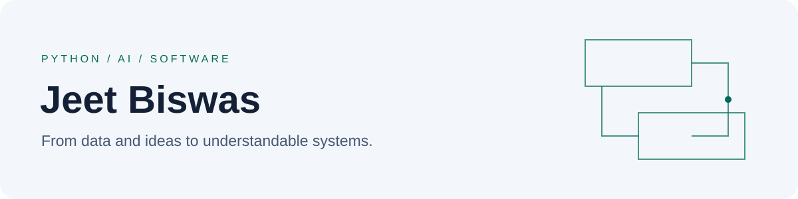

<picture>
  <source media="(prefers-color-scheme: dark)" srcset="assets/profile-dark.svg">
  <source media="(prefers-color-scheme: light)" srcset="assets/profile-light.svg">
  
</picture>

# Jeet Biswas

**Python · Applied AI · Software engineering**

I build Python applications that connect documents, data, and model APIs to useful
interfaces. My work spans document extraction, hosted AI integrations, and
algorithm implementations, with an emphasis on clear behavior and testable code.

[Email](mailto:jeetbiswas816@gmail.com) · [GitHub repositories](https://github.com/jeet-biswas?tab=repositories)

[Selected work](#selected-work) · [Technical toolkit](#technical-toolkit) ·
[Engineering approach](#engineering-approach) · [Current focus](#current-focus) · [Connect](#connect)

## Selected work

[Browse the project index](docs/project-index.md) for implementation scope and source links.

### Filewise — document extraction

**Merged contribution · Python · FastAPI · JavaScript**

Connected TXT, DOCX, and digital PDF extraction to a Drive-backed Chrome extension
through a local API. The contribution includes account-scoped text previews,
extraction status, and retries.

[Project write-up](docs/projects/filewise.md) · [Merged PR #20](https://github.com/SiddharthaGanguli/multimodal-smart-file-organizer/pull/20)

### DSA — algorithms and problem solving

**Learning library · Python · Standard-library tests**

Reusable implementations of binary search, prefix sums, two pointers, sliding
windows, sorting, stacks, and queues. The exercises make input assumptions,
complexity, and edge cases explicit.

[Repository](https://github.com/jeet-biswas/DSA) · [Study guide](docs/projects/dsa.md) · [Tests](https://github.com/jeet-biswas/DSA/tree/master/tests)

### JeetGPT — hosted AI chat

**Prototype · Streamlit · LangChain · Hugging Face**

A chat interface connected to a hosted language model, with environment-based
configuration and session history for display. The write-up covers the request
flow, current limitations, and next engineering steps.

[Repository](https://github.com/jeet-biswas/chatbot) · [Implementation notes](docs/projects/chatbot.md)

More projects — computer vision, web foundations, Unity, and ML

| Project | Implemented scope |
|---|---|
| [Computer vision](docs/projects/computer-vision.md) | OpenCV notebook exercises using pretrained face detectors and bounding-box visualization. |
| [ECG application foundation](docs/projects/ecg-foundation.md) | React/Firebase authentication and a FastAPI scaffold; model work is planned. |
| [Unity prototypes](docs/projects/unity.md) | C# exercises in movement, physics, collision handling, and game state. |
| [ML fundamentals](docs/projects/ml-fundamentals.md) | Perceptron experiments, decision regions, and Pandas exploration. |

## Technical toolkit

Tools used across the [project collection](docs/project-index.md):

| Area | Technologies |
|---|---|
| Applications and APIs | Python, FastAPI, Streamlit |
| AI integrations and experiments | LangChain, Hugging Face, scikit-learn, Pandas |
| Computer vision and notebooks | OpenCV, Matplotlib, Jupyter |
| Web development | JavaScript, React, Vite, Firebase |
| Gameplay prototypes | C#, Unity |
| Development workflow | Git, GitHub Actions, Python unittest |

## Engineering approach

- **Define behavior:** make inputs, expected outputs, and failure states explicit.
- **Keep components testable:** separate parsing, application logic, and interface state.
- **Check the boundaries:** use small examples, reference solutions, and edge-case tests.
- **Document the evidence:** connect implementation claims to source, checks, and known limits.

[Engineering notes and examples](docs/engineering-workflow.md)

## Current focus

- **Document understanding:** extraction workflows, dataset preparation, and evaluation.
- **Reproducible experiments:** clear label definitions, grouped data splits, and traceable results.
- **Algorithm fluency:** reasoning about correctness and time/space tradeoffs through Python practice.

[Read my document data and evaluation notes](docs/data-quality.md)

## Connect

For a project question or collaboration discussion, reach me at
[jeetbiswas816@gmail.com](mailto:jeetbiswas816@gmail.com).
You can also browse [my public repositories](https://github.com/jeet-biswas?tab=repositories).

For a reproducible issue, include the repository, the input or steps you used,
what you expected, and what happened. Please leave access tokens and private
documents out of public issues.

About this profile repository

The project index is generated from reviewed metadata. Local links and artwork
have automated checks. [Editing and validation guide](docs/profile-maintenance.md).

